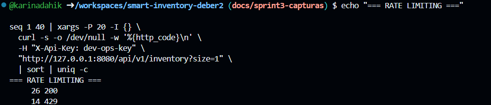
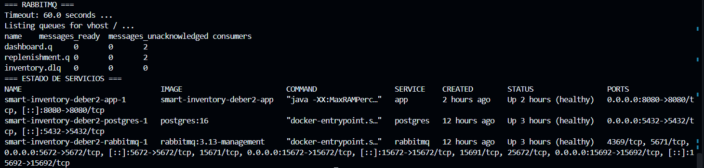
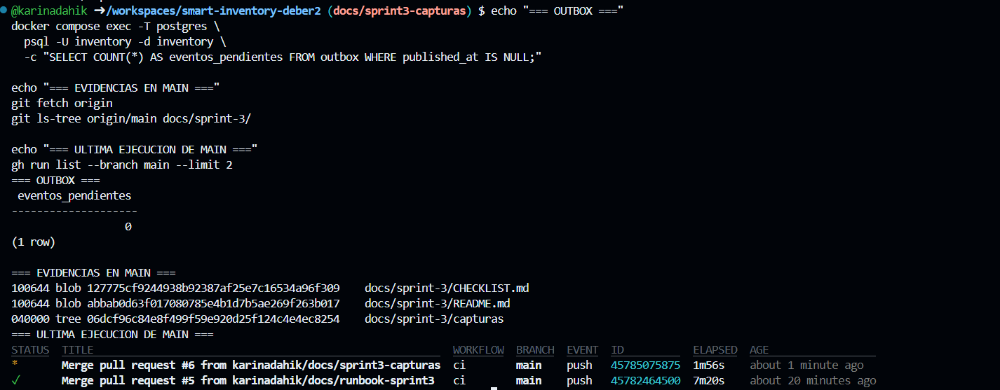

# Cierre técnico del Sprint 3 — Smart Inventory

**Fecha de comprobación:** 26 de noviembre de 2026
**Repositorio:** `karinadahik/smart-inventory-deber2`
**Alcance:** CI/CD, DevSecOps, staging temporal, SAT/DAST, limitación de tráfico y estado operativo de la mensajería.

## Resultados verificados

| Requisito | Evidencia y resultado |
|---|---|
| CI/CD y controles de seguridad | Ejecución #9 en `main`: `secrets-scan`, `build-test`, `sast`, `sca`, `package`, `deploy-staging` y `dast-sat` aprobados. En el cierre integral se verificó además [CI de `main` tras PR #9](https://github.com/karinadahik/smart-inventory-deber2/actions/runs/45870488534). |
| SAT | 14 comprobaciones PASS en Codespaces; SAT automatizado en el job de GitHub Actions. |
| DAST | OWASP ZAP pasivo sobre OpenAPI: 118 PASS y 2 WARN antes; 120 PASS, 0 WARN y 0 FAIL después de añadir cabeceras HTTP. |
| Fallo controlado | En CI #11, ruta de salud inexistente devolvió HTTP 404 y el smoke test bloqueó el job. En CI #12, tras restaurar la validación, las comprobaciones volvieron a aprobarse. |
| Rate limiting | 40 solicitudes concurrentes: 26 respuestas HTTP 200 y 14 HTTP 429. |
| Mensajería | `dashboard.q` y `replenishment.q`: 0 mensajes en espera, 2 consumidores cada una. `inventory.dlq`: 0 mensajes en espera. |
| Outbox | Consulta SQL de eventos no publicados: 0 pendientes. |
| Disponibilidad | API, PostgreSQL y RabbitMQ figuraron `healthy` en la validación local. |
| Documentación | `docs/sprint-3/` presente en `main` tras el Merge del PR #6. |

## Evidencias adicionales

### E14 — Rate limiting

La prueba concurrente muestra respuestas autorizadas (200) y limitadas (429). Verifica la aplicación de la política de limitación de solicitudes en el entorno local de prueba.

### E15 — Mensajería y disponibilidad

RabbitMQ no mostraba mensajes pendientes en las colas consultadas. La aplicación, PostgreSQL y RabbitMQ estaban saludables. Esto constata el estado operativo en el instante de observación.

### E16 — Outbox y documentación integrada

La consulta SQL devolvió cero eventos pendientes de publicación. `git ls-tree origin/main docs/sprint-3/` mostró los documentos y la carpeta de capturas integrados. **La ejecución más reciente de `main` estaba aún en curso en esta captura; no se considera evidencia de aprobación final.**

## Alcance y limitaciones

- El staging demostrado es **temporal en runners de GitHub Actions**, no un ambiente persistente.
- El ensayo CI #11 demuestra **bloqueo seguro** y CI #12 la **recuperación de la validación**. **No se ejecutó rollback de una versión persistente**. La consigna solicita rollback o detención; en la defensa debe explicarse esta diferencia.
- Las colas vacías y un Outbox sin pendientes **no prueban por sí solos recuperación de RabbitMQ, reintentos o DLQ ante fallos**. Esas capacidades deben apoyarse con pruebas específicas o señalarse como cobertura pendiente.
- El DAST realizado fue una revisión **pasiva**, no un pentest ni un escaneo activo exhaustivo.
- En el cierre final del proyecto se comprobó el CI de `main` posterior al PR #8 ([ejecución 45863252563](https://github.com/karinadahik/smart-inventory-deber2/actions/runs/45863252563), `success`). Sigue pendiente confirmar si el docente acepta staging temporal y bloqueo seguro como evidencia suficiente frente a rollback persistente.

Las evidencias E04 a E13 se documentan en el [índice principal](README.md); el [checklist del Sprint 3](CHECKLIST.md) contiene el resto de verificaciones.
