# Sprint 3 — CI/CD, DevSecOps, staging y resiliencia

**Proyecto:** Smart Inventory · Desarrollo de Software Moderno
**Estado:** cierre técnico documentado y respaldado por capturas; evaluación/validación del docente no acreditada. El release final `v1.0.0` y CI posterior de `main` se verificaron al cerrar el proyecto.
**Base:** resultados observados en Codespaces y GitHub Actions el 26 de noviembre de 2026.

> **Alcance:** las capturas de esta carpeta documentan resultados reales. El staging implementado en GitHub Actions es **temporal**, creado con Docker Compose y eliminado después de las pruebas. Se demostró el **bloqueo seguro** y la **recuperación del pipeline** tras un fallo intencional, **no** el rollback de un despliegue persistente. Estas evidencias no sustituyen la validación final del profesor.

## Relación con el Sprint 3

El Sprint 3 solicita automatización CI/CD con controles DevSecOps, imagen versionada, staging, SAT/DAST, rate limiting y resiliencia. Los recursos principales están en [`.github/workflows/ci.yml`](../../.github/workflows/ci.yml), [`scripts/sat.sh`](../../scripts/sat.sh), [`docs/runbook.md`](../runbook.md) y [`docs/experiments/smoke-failure.md`](../experiments/smoke-failure.md).

## E04 — Runtime en Codespaces y salud del servicio

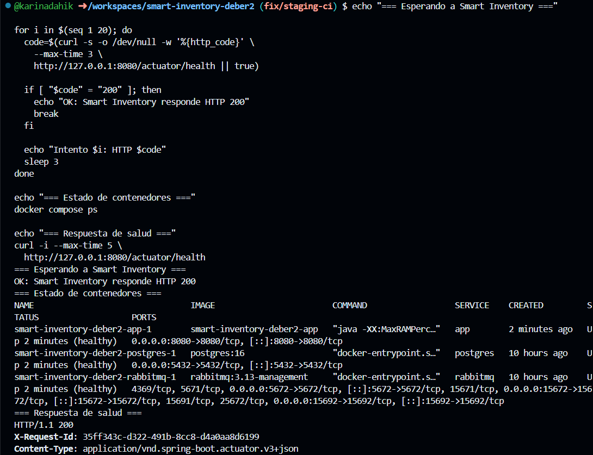

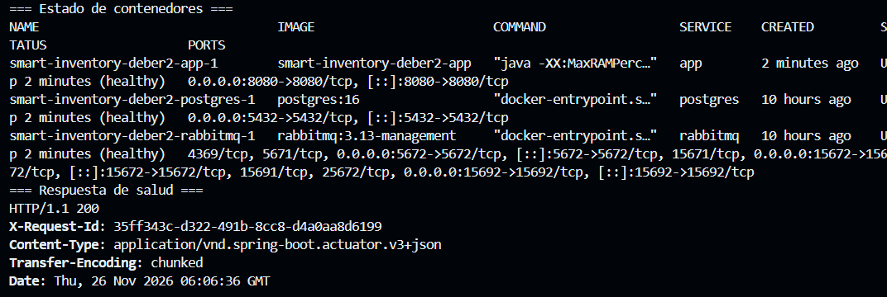

**Resultado observado:** Spring Boot, PostgreSQL y RabbitMQ reportaron estado saludable; `/actuator/health` respondió HTTP 200. Es una comprobación **local en Codespaces**, no evidencia de staging persistente.

## E05 — Pruebas de aceptación SAT

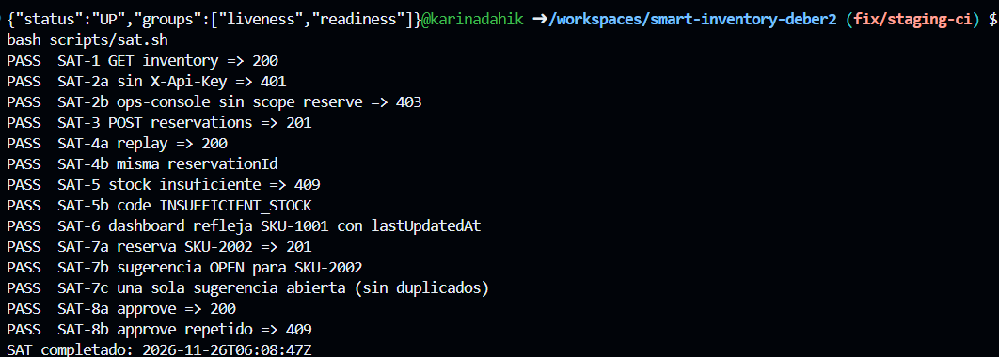

**Resultado observado:** 14 comprobaciones PASS de ocho escenarios SAT: lectura de inventario; autenticación/autorización 401/403; reserva FEFO; idempotencia; stock insuficiente 409; dashboard; reposición; aprobación y prevención de duplicados. Este resultado corresponde a la ejecución local.

## E06 — DAST antes de la corrección

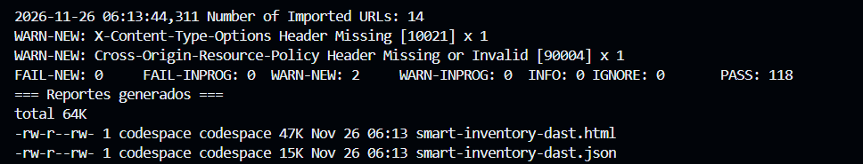

**Resultado observado:** OWASP ZAP importó 14 URL y reportó **118 PASS, 2 WARN y 0 FAIL**. Las advertencias eran la ausencia de `X-Content-Type-Options` y `Cross-Origin-Resource-Policy`.

## E07 — Mitigación HTTP verificada

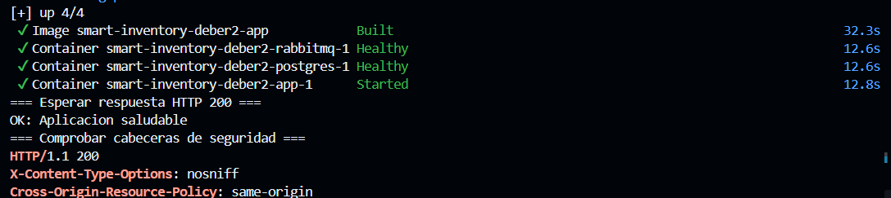

**Resultado observado:** la API envió `X-Content-Type-Options: nosniff` y `Cross-Origin-Resource-Policy: same-origin` en una respuesta HTTP 200. Implementación: [`SecurityHeadersFilter.java`](../../src/main/java/ec/usfq/smartinventory/web/SecurityHeadersFilter.java).

## E08 — DAST después de la corrección

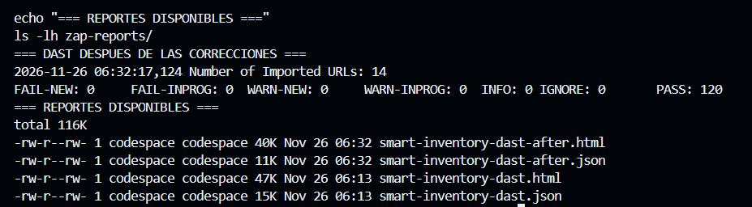

**Resultado observado:** segundo escaneo pasivo de ZAP, **120 PASS, 0 WARN y 0 FAIL** para las 14 URL importadas. Esta mejora evidencia el ciclo de detectar, corregir y volver a verificar; no prueba ausencia absoluta de vulnerabilidades. El análisis se realizó en Codespaces. Los reportes originales HTML/JSON no están incluidos en el paquete base inspeccionado; pueden recuperarse como artefactos de las ejecuciones de CI que sigan disponibles. Ver [triaje DAST](../security/DAST_TRIAGE.md).

## E09 — Validación automática desde un Pull Request

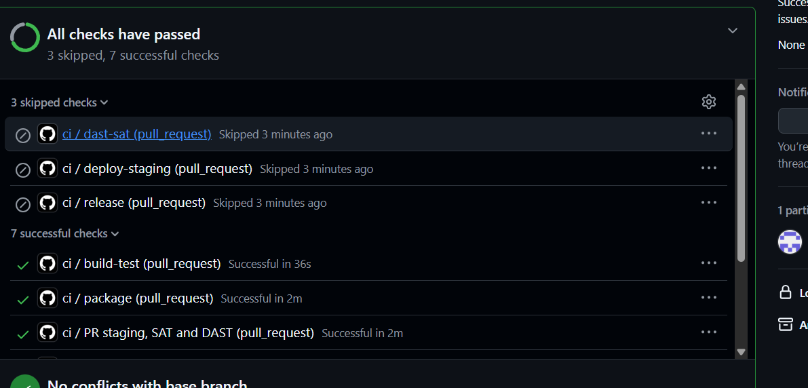

**Resultado observado:** controles de seguridad, build, empaquetado y el job `PR staging, SAT and DAST` aprobados en el PR #2. [Ver PR #2](https://github.com/karinadahik/smart-inventory-deber2/pull/2).

## E10 — Pipeline desde `main`

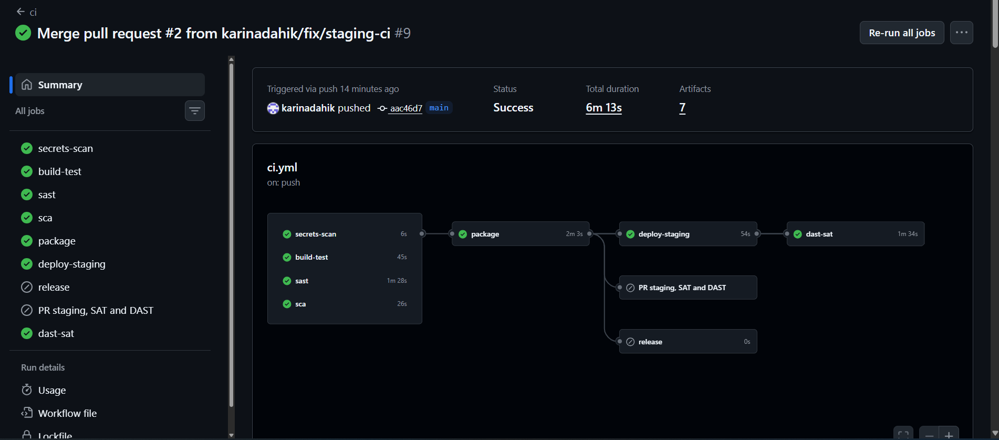

**Resultado observado:** en CI #9 (commit `aac46d7`) pasaron `secrets-scan`, `build-test`, `sast`, `sca`, `package`, `deploy-staging` y `dast-sat`. Se ejecutaron pruebas en entornos efímeros dentro de GitHub Actions. [Ver GitHub Actions](https://github.com/karinadahik/smart-inventory-deber2/actions).

## E11 — Fallo controlado y bloqueo seguro

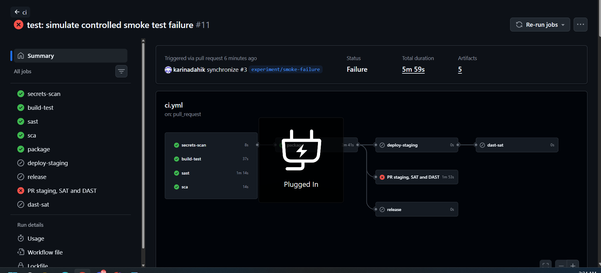

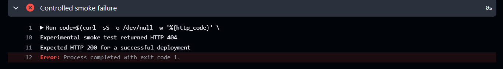

**Resultado observado:** tras comprobar que la aplicación había iniciado, el paso experimental `Controlled smoke failure` pidió `/actuator/health/forced-failure`, recibió **HTTP 404** en vez de 200 y GitHub Actions terminó ese paso con **exit code 1**. El job de PR quedó bloqueado. Se realizó en una rama aislada que **no fue fusionada con `main`**. [Ver PR experimental #3](https://github.com/karinadahik/smart-inventory-deber2/pull/3).

## E12 — Recuperación del pipeline

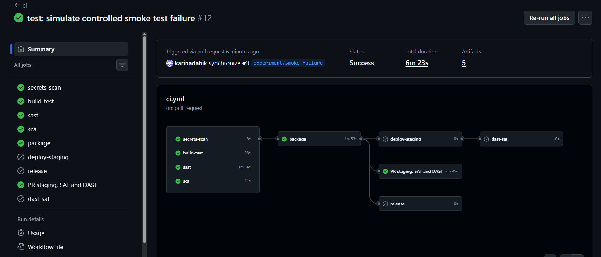

**Resultado observado:** se quitó el paso experimental, se restauró la comprobación original y CI #12 aprobó de nuevo el job `PR staging, SAT and DAST`. **No se ejecutó rollback de un despliegue persistente.** La secuencia se describe en [`docs/experiments/smoke-failure.md`](../experiments/smoke-failure.md).

## E13 — Validación documental del runbook

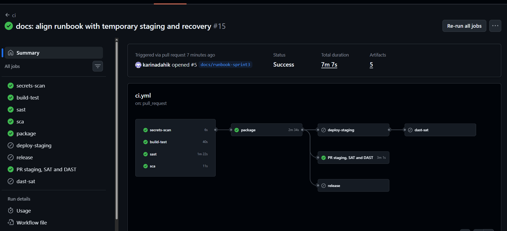

**Resultado observado:** las verificaciones del PR #5, relativo a la documentación del runbook, resultaron aprobadas. Posteriormente se informó su integración a `main`. [Ver PR #5](https://github.com/karinadahik/smart-inventory-deber2/pull/5).

## Limitaciones y pendientes de cierre

1. **Staging:** es temporal, no persistente ni equivalente a producción; cada job inicia su propio entorno.
2. **Rollback:** el experimento demostró fallo, bloqueo y recuperación de la CI. No hubo rollback de una aplicación persistente ni conmutación real a un tag anterior.
3. **DAST:** se ejecutó un análisis pasivo OpenAPI; no equivale a un pentest ni a una revisión autenticada integral.
4. **Rate limiting y resiliencia:** existen pruebas locales previas de HTTP 429 y mecanismos de Outbox/DLQ, pero conviene asegurar evidencia explícita y vincularla con criterios del Sprint 3.
5. **Ejecución de `main`:** el cierre integral posterior al PR #9 tiene CI [aprobada](https://github.com/karinadahik/smart-inventory-deber2/actions/runs/45870488534).
6. **Informe final:** el [índice integral](../ENTREGA_Y_RUBRICA.md) conecta los cuatro sprints; el [guion de demo](../DEMO_FINAL_10_12_MIN.md) no equivale a una grabación.

**Referencias del repositorio:** [GitHub Actions](https://github.com/karinadahik/smart-inventory-deber2/actions) · [Runbook](../runbook.md) · [Experimento](../experiments/smoke-failure.md).

## Cierre del Sprint 3

Ver [resultados finales y evidencias E14-E16](CIERRE.md).
